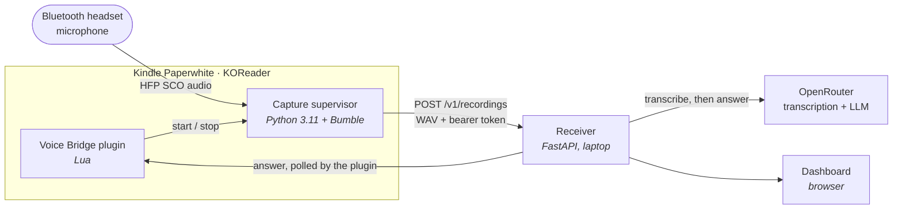

# Kindle Voice Bridge

Ask an LLM a question out loud while reading on a Kindle.

[](https://github.com/jamestkusek/kindle-voice-bridge/actions/workflows/tests.yml)
[](pyproject.toml)
[](LICENSE)

## Why

I read a lot on my Kindle, and while I love it dearly, it has simply not kept up with the times. I. Constantly I want to ask an LLM something the built-in dictionary can't answer: 
which section of this textbook explains the Pareto principle ? 
what does this victorian expression mean ?
remind me why Voldemort hates Harry Potter ?

There is already a partial solution to this. You can install a document reader called KOReader on Kindle, which  already has an LLM plugin that you can type questions to.

There is one crucial drawback to this. Typing on a Kindle keyboard sucks. It’s like a phone keyboard, but 5x slower and with a much lower refresh rate. However…most Kindles do support Bluetooth devices, and a Bluetooth headset has a microphone. So what if we could speak to the LLM instead ?


## What it does

1. Allows the user to ask questions via a plugin in KOReader
2. The Kindle uploads the audio file over Wi-Fi to the receiver
3. The receiver transcribes the audio with a model of your choosing (BYOK), processes a response using an LLM (BYOK, and returns a
   short answer.
4. A local dashboard lists recordings, transcripts and answers.

A /debug page gives insight into the full pipeline and allows tracing of questions and answers.
Here you can also choose API keys for the transcription and answer models and edit their system prompt.
The system knowledge is also stored here (all the books the user has on their Kindle) to provide more accurate responses.

## How it works



Basically, the Capture Supervisor takes over the Bluetooth chip on the Kindle, opens the headset microphone, records your question, and
 sends the audio over to the receiver with a few details about the book, page you are on etc, where an LLM answers your question, and sends the response back to the Kindle.


# Getting started

## Requirements

- A computer with Windows and Python 3.11 or later.
- A Kindle Paperwhite 10th edition
- A Bluetooth headset.

## Setup

### Preliminary: Install the runtimes on the Kindle

This is a one-time step. The Kindle has no system Python, so it needs a portable
runtime and the Bumble Bluetooth stack.

1. Stage the two bundles on the host:
   - `build/python31117/` — portable CPython 3.11.17 (ARMv7, glibc 2.20).
   - `build/bumble-kindle/` — Bumble 0.0.236 and its pure-Python dependencies.
   The exact package versions are pinned in
   [docs/bumble-bundle-manifest.txt](docs/bumble-bundle-manifest.txt).
2. Connect the Kindle over USB and run:

   ```powershell
   .\tools\kvb.ps1 install-runtimes -KindleRoot D:\
   ```

   The command checks both bundles, verifies the Bumble bundle, and copies them
   to `/mnt/us/kindle-voice-bridge/`. It skips runtimes that are already
   installed. Use `-Force` to replace them, or `-BundleRoot` if the bundles are
   not under `build\`.
3. Pair the headset in the Kindle's Bluetooth settings and enable Bluetooth.
   Put the Kindle on the same Wi-Fi network as the laptop.

The command copies the staged bundles. It does not download them. The `deploy`
command copies the application files only; it does not copy either runtime.

### 1. Jailbreak the Kindle and install KOReader

KOReader is the reader that hosts the plugin. The Kindle Modding community
maintains a clear [jailbreak guide](https://kindlemodding.org/jailbreaking/index.html)
that covers jailbreaking the device and installing KOReader.

### 2. Install the receiver

Run this command from the project directory in PowerShell:

```powershell
python -m pip install -e .
```

### 3. Start the receiver

```powershell
.\tools\kvb.ps1 receiver
```

The receiver listens on port 18767. On this computer, the dashboard is at
`http://127.0.0.1:18767/`; its health check is at `/healthz`. The dashboard
shows each recording, its transcript and its answer.

The server stores recordings in `%LOCALAPPDATA%\KindleVoiceBridge\recordings`.
Transcription and answering switch on when
`server/voice_bridge_server/voxtral-openrouter-key.txt` exists. Put your
OpenRouter API key in that file on a single line, with no quotes. The file is
gitignored. Without it the receiver still accepts uploads, but it does not
transcribe or answer them.

Add `-LocalOnly` to bind the receiver to this computer only. Stop or restart
the receiver with:

```powershell
.\tools\kvb.ps1 stop
.\tools\kvb.ps1 restart
```

If the execution policy blocks the script, run this command:

```powershell
powershell -NoProfile -ExecutionPolicy Bypass -File tools\kvb.ps1 receiver
```

### 4. Connect the Kindle and copy the files

1. Connect the Kindle to your PC with a USB cable.
2. Run this command with the drive letter of the Kindle (normally D, as shown in the command):

   ```powershell
   .\tools\kvb.ps1 deploy -KindleRoot D:\ -ServerUrl http://<laptop-ip>:18767
   ```

The command copies the KOReader plugin and the logic that captures Bluetooth
audio from a connected headset and uploads it.

It also writes `/mnt/us/kindle-voice-bridge/upload.json`, which holds
`server_url` and `token`, so the Kindle knows where to upload and how to
authenticate. If the laptop's LAN IP changes, rerun the command with the new
`-ServerUrl` and `-Force`. Without `-ServerUrl`, deploy leaves the existing file
alone. The token is in `.data\receiver-config.json` if you need to edit the file
by hand.

### 5. Make the first recording

1. Open the Voice Bridge plugin in KOReader.
2. Select **Start Bluetooth session**. Confirm the action.
3. Select **Ask question**. A strip opens along the bottom edge of the screen.
   You can also assign the **Voice Bridge: start/stop recording** Dispatcher
   action to a gesture.
4. Wait for **SPEAK NOW** and the countdown.
5. Ask the question, then tap the strip to stop and send.
6. The strip shows **SENT**, then **RESPONSE READY** when the answer arrives.
7. Tap the strip to read the answer. Closing the popup closes the strip.
8. When you are finished, select **Stop Bluetooth session** to restore stock
   Bluetooth.

The dashboard shows the recording, its transcript and the answer, and updates
live as new ones arrive.

## Tests

The suite needs no Kindle, headset or network: the device and receiver layers
run with mocked components.

```powershell
python -m pip install -e ".[test]"
.\tools\kvb.ps1 test
```


## Where to go next

- [docs/one-pager.md](docs/one-pager.md): the project pitch and the next steps.
- [docs/architecture.md](docs/architecture.md): how the system works.
- [docs/protocol.md](docs/protocol.md): the upload contract.
- [docs/hardware-tests.md](docs/hardware-tests.md): hardware results, the laptop
  capture commands, and the resident session protocol.
- [docs/transcription.md](docs/transcription.md): the model comparison and the
  cost per clip.
- [docs/review-ui.md](docs/review-ui.md): the dashboard and its endpoints.
- [docs/recovery.md](docs/recovery.md): the Bluetooth recovery commands.
- [ai.md](ai.md): how AI was used to build the project.
- [agent-plan.md](agent-plan.md): the coordinator brief that split the work
  between the two models.
- [PLAN.md](PLAN.md): the original project plan and the hardware precautions.
